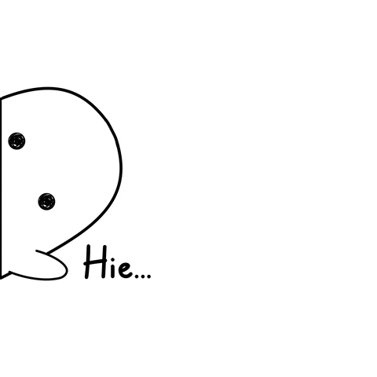

## 🚀 About Me
- 📱 iOS (UIKit, SwiftUI, Combine)
- 🤖 Android (Kotlin, Jetpack Compose, Coroutines)
- 🐦 Flutter (Riverpod)
---

## ⏱️ WakaTime Stats


---

## 📊 Weekly Coding Activity

<!--START_SECTION:waka-->

```txt
Markdown     1 hr 53 mins          ██████████▒░░░░░░░░░░░░░░   41.19 %
Python       48 mins               ████▒░░░░░░░░░░░░░░░░░░░░   17.62 %
Bash         40 mins               ███▓░░░░░░░░░░░░░░░░░░░░░   14.86 %
Other        29 mins               ██▓░░░░░░░░░░░░░░░░░░░░░░   10.67 %
Dart         19 mins               █▓░░░░░░░░░░░░░░░░░░░░░░░   06.97 %
```

<!--END_SECTION:waka-->

---

## 🛠 Tech Stack

### iOS


### Android


### Flutter


---

## 📈 GitHub Stats


