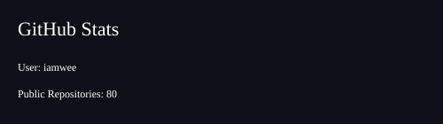

## 🚀 About Me
- 📱 iOS (UIKit, SwiftUI, Combine)
- 🤖 Android (Kotlin, Jetpack Compose, Coroutines)
- 🐦 Flutter (Riverpod)
---

## ⏱️ WakaTime Stats


---

## 📊 Weekly Coding Activity

<!--START_SECTION:waka-->

```txt
Markdown     11 hrs 18 mins        ████████▒░░░░░░░░░░░░░░░░   33.00 %
Other        9 hrs 29 mins         ███████░░░░░░░░░░░░░░░░░░   27.73 %
JavaScript   4 hrs 6 mins          ███░░░░░░░░░░░░░░░░░░░░░░   12.00 %
Python       4 hrs 2 mins          ███░░░░░░░░░░░░░░░░░░░░░░   11.82 %
TypeScript   2 hrs                 █▒░░░░░░░░░░░░░░░░░░░░░░░   05.85 %
```

<!--END_SECTION:waka-->

---

## 🛠 Tech Stack

### iOS


### Android


### Flutter


---

## 📈 GitHub Stats


