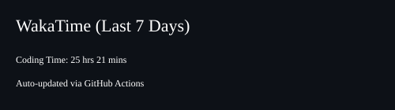

## 🚀 About Me
- 📱 iOS (UIKit, SwiftUI, Combine)
- 🤖 Android (Kotlin, Jetpack Compose, Coroutines)
- 🐦 Flutter (Riverpod)
---

## ⏱️ WakaTime Stats



---

## 📊 Weekly Coding Activity

<!--START_SECTION:waka-->

```txt
Markdown     20 hrs 16 mins        ███████████████▒░░░░░░░░░   61.35 %
JavaScript   4 hrs 15 mins         ███▒░░░░░░░░░░░░░░░░░░░░░   12.90 %
Other        2 hrs 40 mins         ██░░░░░░░░░░░░░░░░░░░░░░░   08.11 %
Python       2 hrs 31 mins         ██░░░░░░░░░░░░░░░░░░░░░░░   07.64 %
Bash         1 hr 11 mins          █░░░░░░░░░░░░░░░░░░░░░░░░   03.61 %
```

<!--END_SECTION:waka-->

---

## 🛠 Tech Stack

### iOS


### Android


### Flutter


---

## 📈 GitHub Stats


