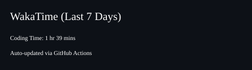
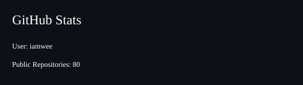

## 🚀 About Me
- 📱 iOS (UIKit, SwiftUI, Combine)
- 🤖 Android (Kotlin, Jetpack Compose, Coroutines)
- 🐦 Flutter (Riverpod)
---

## ⏱️ WakaTime Stats



---

## 📊 Weekly Coding Activity

<!--START_SECTION:waka-->

```txt
Markdown     11 hrs 13 mins        █████████░░░░░░░░░░░░░░░░   35.63 %
Other        9 hrs                 ███████░░░░░░░░░░░░░░░░░░   28.61 %
Dart         3 hrs                 ██▒░░░░░░░░░░░░░░░░░░░░░░   09.55 %
Python       2 hrs 14 mins         █▓░░░░░░░░░░░░░░░░░░░░░░░   07.11 %
JavaScript   1 hr 30 mins          █▒░░░░░░░░░░░░░░░░░░░░░░░   04.78 %
```

<!--END_SECTION:waka-->

---

## 🛠 Tech Stack

### iOS


### Android


### Flutter


---

## 📈 GitHub Stats


